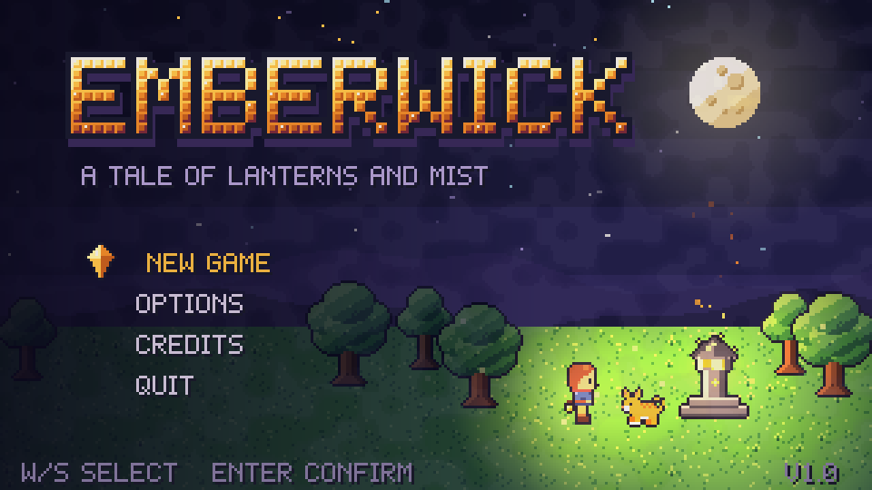
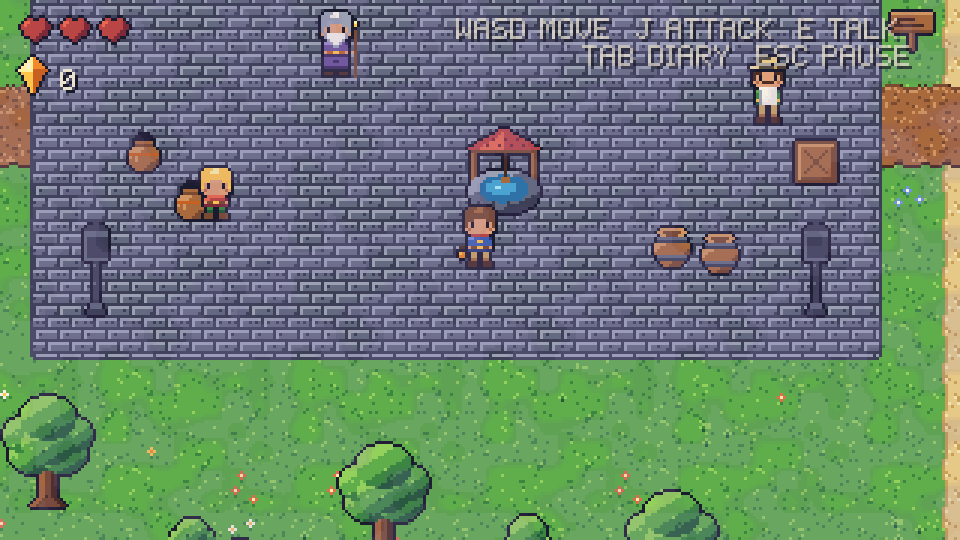
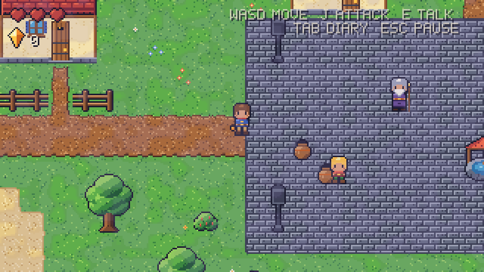
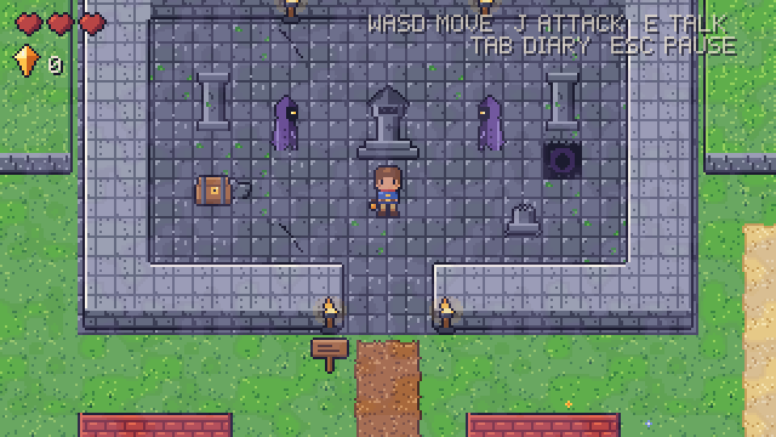
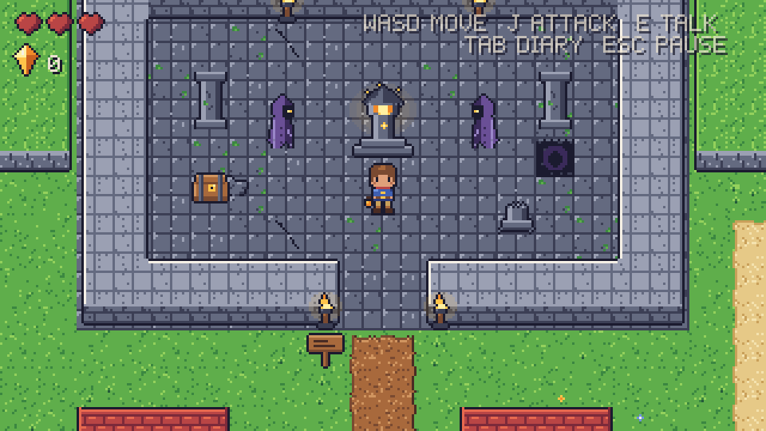
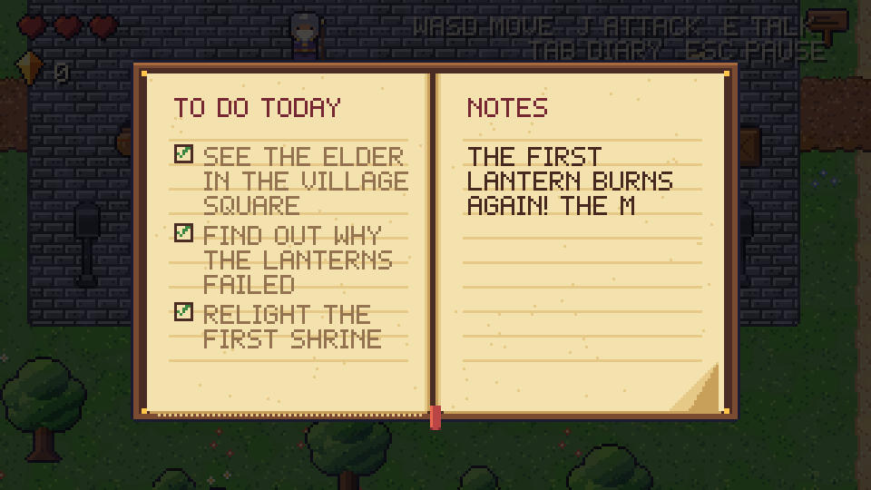

<div align="center">


# Emberwick

**A tale of lanterns and mist**

A cozy top-down pixel art adventure made with Godot 4.7.




</div>

---

## The story

The lanterns that keep the night-mist out of the village have gone dark.

You are the young lantern-keeper. You wake in your house, read yesterday's diary, and step out into a village that is waiting for someone to do something. The elder knows where the first shrine stands: past the river, through the Mistwood, inside an old ruin.

Light it, and the mist lifts.

## Screenshots

| | |
|:---:|:---:|
|  |  |
| **The village square** | **The outskirts** |
|  |  |
| **The ruin, lost in mist** | **The shrine, relit** |
|  | |
| **The keeper's diary** | |

## Features

- **A complete short adventure.** A village, a river and bridge, the Mistwood and a ruin with a lantern shrine to relight.
- **A scripted opening.** Story cards, an eyelid wake-up transition, inner thoughts and a diary that writes itself.
- **Villagers with voices.** The elder, the shopkeeper and a child each speak their lines, and the text reveals in step with the voice.
- **Mist creatures.** Slimes and bats in the woods, and slower, tougher shades in the ruin.
- **A living diary.** It tracks your tasks and rewrites its notes as the story moves on.
- **Music that follows you.** Separate looping themes for the village, the Mistwood and the ruin, with crossfades between them.
- **Title, pause and options menus.** Volume for music, sound and voice, plus fullscreen, saved between runs.

## Controls

| Action | Keys |
|---|---|
| Move | `W` `A` `S` `D` or arrow keys |
| Attack | `J` or `Space` |
| Talk / open / read | `E` or `Enter` |
| Diary | `Tab` or `Q` |
| Pause | `Esc` or `P` |
| Skip the intro | `Esc` during the opening |

Menus also work with the mouse.

## Play it

### From the editor

1. Install [Godot 4.7.1](https://godotengine.org/download) (standard build).
2. Clone this repository and open `project.godot`.
3. Press **F5**.

### Build a Windows .exe

The repository includes a `Windows Desktop` export preset that produces a single self-contained `Emberwick.exe`.

```bash
godot --headless --path . --export-release "Windows Desktop" builds/Emberwick.exe
```

The preset points `custom_template/debug` and `custom_template/release` at a local folder. Either change those two paths in `export_presets.cfg` to where your Windows export templates live, or clear them and install the templates through **Editor → Manage Export Templates**.

## How it was made

Almost nothing in Emberwick was drawn or recorded by hand.

- **Art** is generated by Python scripts in `tools/`. Each script places pixels from one shared 36-colour palette and writes PNG sprite sheets, so every asset matches and a palette change regenerates the whole game.
- **Sound effects** are synthesized by `tools/gen_sfx.py`.
- **Music, jingles and voices** come from `tools/gen_audio.py`, which calls generative audio models through OpenRouter.
- **Godot resources** (the `TileSet` and every `SpriteFrames`) are built from the sheets by `scripts/editor/build_resources.gd`.

### Art direction

| Setting | Choice |
|---|---|
| Tiles | 16×16 |
| Characters | 16×24, in 32×32 cells for the player so sword swings fit |
| Viewport | 320×180, integer-scaled, nearest-neighbour |
| Palette | One fixed palette of 36 colours |
| Style | Dark outlines, light from the top-left, three shades per material |

### Regenerating the assets

Needs Python 3.11 and Pillow.

```bash
cd tools
python gen_terrain.py && python gen_player.py && python gen_npcs.py && python gen_enemies.py
python gen_props.py && python gen_fx_ui.py && python gen_village_ruin.py && python gen_interior.py
python gen_title.py && python gen_sfx.py
cd ..
godot --headless --path . --import
godot --headless --path . --script res://scripts/editor/build_resources.gd
```

`gen_audio.py` is the only script that costs money to run. It reads its key from the `OPENROUTER_API_KEY` environment variable.

## Project layout

```
project.godot        320×180, nearest-neighbour filtering, pixel snap
assets/              sprite sheets, tilesets, UI, music, sound effects, voices
resources/           generated TileSet and SpriteFrames
scenes/              title.tscn (entry point) and main.tscn (the game)
scripts/game/        player, enemies, NPCs, dialogue, diary, intro, menus, audio
scripts/editor/      build_resources.gd
tools/               Python generators for art and audio
docs/screenshots/    images used in this README
PLAN.md              the original design plan and build notes
```

## Status

Emberwick is a playable vertical slice, not a finished game.

- Art exists for a locked door, key, pushable block and floor switch, but they have no gameplay yet.
- The pit tile is decorative.
- Enemy AI and combat are deliberately simple.

`PLAN.md` has the full design plan and the notes on what changed along the way.

## Credits

Designed, programmed and illustrated through code by Claude (Anthropic), working with a human director. Built with the [Godot Engine](https://godotengine.org).
